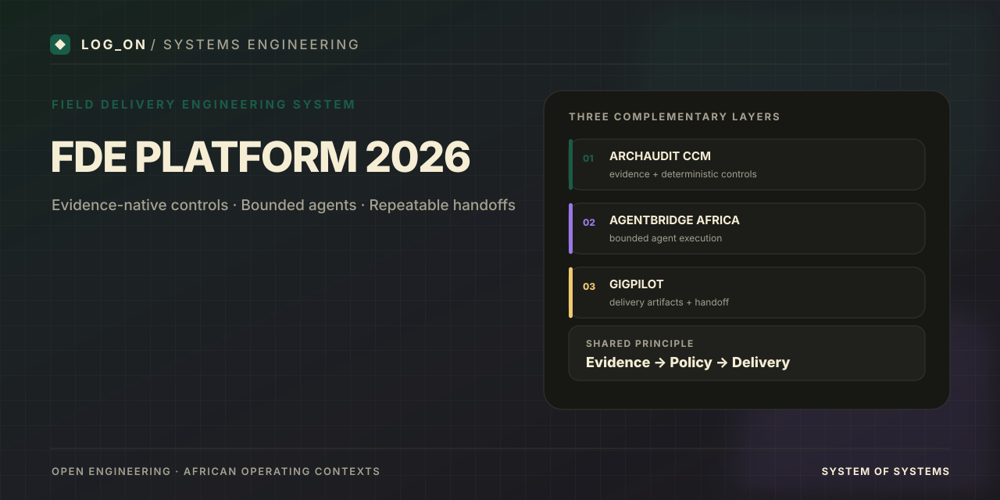

# FDE Platform 2026

  

---

## Repositories

| Component | Repository | Role |
|-----------|------------|------|
| **ArchAudit CCM** | [ArchAudit-CCM](https://github.com/Logonotobscurity/ArchAudit-CCM) | Deterministic-first Continuous Control Monitor |
| **AgentBridge Africa** | [AgentBridge-Africa](https://github.com/Logonotobscurity/AgentBridge-Africa) | Multi-agent bridge with hard budgets & regional profiles |
| **GigPilot** | [GigPilot](https://github.com/Logonotobscurity/GigPilot) | FDE engagement kit (discovery → handoff) |

## End-to-end demo path

Use the component repositories for executable demonstrations; this repository is the system map.

1. **ArchAudit CCM:** install dependencies, run `make run-sample`, and inspect `samples/audit_pack/`.
2. **AgentBridge Africa:** run `make eval` to exercise the offline golden-trajectory harness. Payment adapters are stubbed for evaluation safety.
3. **GigPilot:** run `python scripts/check_pack.py` to validate the example delivery packs.

These are separate repositories, so run each command from that component's own repository root. Record short terminal captures only after confirming the commands pass locally; do not imply a live payment transaction or unverified test result.

## Social preview

The README banner is stored at `docs/assets/social-preview.svg`. To set the card shown when this repository link is shared, upload the corresponding 1280×640 PNG via **Settings → General → Social preview**. The README image and GitHub's social preview setting are independent.

## Positioning

Evidence is the source of truth. Deterministic rules first. Policy-gated agent assistance. Regional concerns live in adapters and packs, not core evaluation logic.

Originally packaged in the Google Drive folder `FDE-Platform-2026`. All content has been pushed to the dedicated repositories above.

## Visual assets

Each repository includes a visual assets checklist. Generate 1280×640 social previews and set them in repository Settings.
